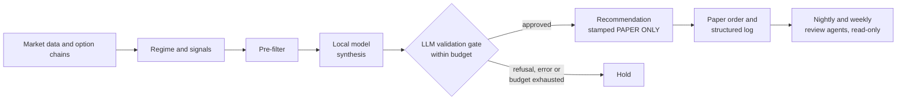

# Options Agent

An agent that watches the market on a five-minute cycle, analyses option chains, and writes fully specified trade recommendations, with an LLM gate that every recommendation has to pass.

It is a decision-support and research system. It runs in observation mode: every recommendation is stamped `UNVALIDATED — PAPER ONLY`, and orders go to a broker paper account. Nothing here is financial advice.

## How it is put together

The system has two tracks.

**Track A, offline strategy validation.** A candidate strategy has to earn its place before it may produce recommendations: explicit machine-readable rules, a rule-consistency check for look-ahead, a backtest with costs, optimisation on in-sample data only, Monte Carlo and parameter-sensitivity checks, then an acceptance bar. A backtest pass is not enough; the strategy must then meet forward criteria that were frozen in `config/` before the forward test began.

**Track B, the live cycle.** Every five minutes during market hours the agent builds a regime view, computes signals for the watchlist, pre-filters, asks a local model to synthesise, and sends the survivors to a cloud model for validation within a daily call budget and a per-ticker cooldown.



Three design choices carry most of the weight:

- **The gate fails closed.** A refusal, an API error or an exhausted budget all resolve to "hold". No answer never means "go".
- **Live mode is refused, not warned about.** `src/engine/live_gate.py` checks for a validated strategy, a forward-acceptance pass and live credentials. Without all of them the agent will not start in live mode, and the live execution layer is not built.
- **Review agents are read-only.** The nightly operations and weekly review agents run under the written charters in `agents/`. They have no write or execute tools; they verify, interpret and report, and are told to prefer "unverified" to a guess.

## What is in the repository

| Path | What it holds | Size |
|---|---|---|
| `src/engine/` | The cycle: candidate pipeline, option selection, risk, exits, paper trading, the live gate and a watchdog | 17 files |
| `src/data/` | Market-data and broker clients (paper and sandbox) | 19 files |
| `src/llm/` | Local-model and cloud-model clients, and their prompts | 2 files plus prompts |
| `src/backtest/`, `src/research/` | Validation pipeline and research studies | 65 files |
| `src/rvol_exec/`, `src/trendbook/` | Two execution lanes with their own guards | 17 files |
| `src/api/`, `ui/` | Local API and a React cockpit | 9 Python files, 41 UI files |
| `tests/` | Unit and behaviour tests | 113 test files, 1,537 tests |
| `config/` | Strategy rules and pre-registered acceptance criteria | 19 files |
| `agents/` | Charters for the scheduled review agents | 2 files |
| `scripts/`, `deploy/`, `launchd/` | Operations: scheduling, dead-man check, restarts, backups | 99 scripts, 29 job definitions |

In total: 342 Python files and about 78,500 lines of Python.

## What this copy is

This is a public export of a private working repository, taken at one point in time. It is published to show the design and the engineering, not as a ready-to-run product.

Left out on purpose:

- **Commit history.** This copy starts from a single export commit; later commits are changes made to the export itself.
- **Market data.** All data files are removed, including the bar fixtures some tests read, so those tests fail here.
- **Research workspace, internal notes and run journals.** The studies behind the configuration, and the daily operations reports.
- **Logs.**

Changed on purpose:

- **Machine paths** in scripts and job definitions are replaced with `/Users/you`.
- **Paper-account identifiers** are replaced with placeholders.

## Running the tests

```bash
python3 -m venv .venv && source .venv/bin/activate
pip install -r requirements.txt
python -m pytest
```

`pytest.ini` also lists `analysis/squeeze_buyzone/tests`; that folder belongs to the research workspace and is not in this copy.

All 1,537 tests are collected in this copy. The full suite has not been run against the export, and the tests that read market-data fixtures need data that is not included.

## Running the agent

Running the cycle needs your own market-data keys, a broker paper account and a local model. `.env.example` lists the settings. The job definitions under `deploy/` and `launchd/` are macOS `launchd` files and need your own paths.

## Limits

- Observation mode only. No strategy is presented here as validated for real money.
- Options backtests model option prices on top of signals from the underlying. That is an approximation by design, not a replay of historical option quotes.
- Built for one machine (Apple Silicon, macOS). Nothing here is packaged for deployment elsewhere.
